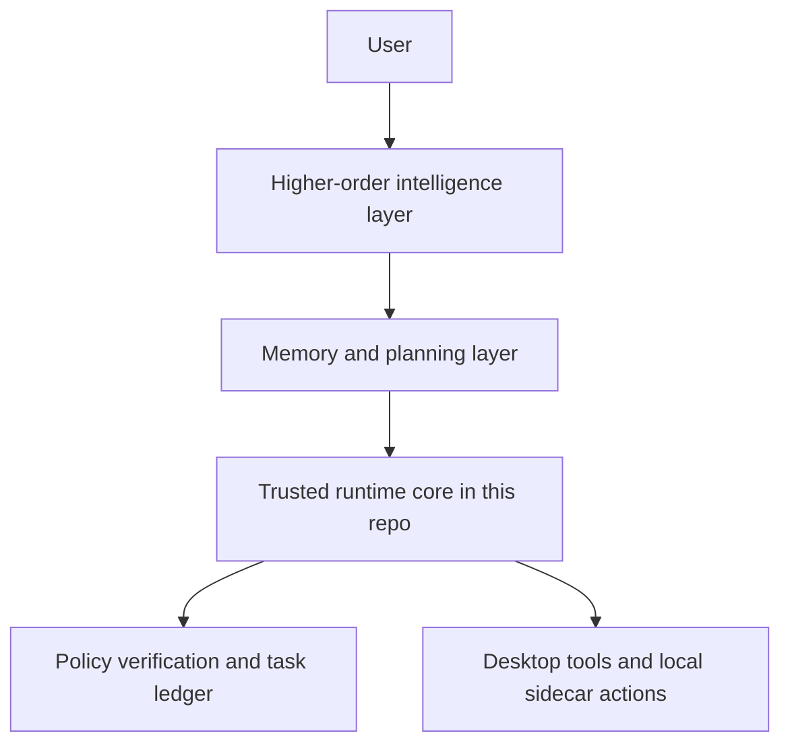

# Sythion Intelligence Architecture

## Purpose

This repository is the **trusted runtime core** of a larger intelligence system.
It is not the entire intelligence system by itself.

The broader vision can include richer conversation, long-horizon planning,
persistent memory, strategy, and multi-device orchestration. But those higher
layers must sit **above** this runtime and must not bypass its trust,
verification, or audit guarantees.

## Layered stack

### Layer 1 — Trusted runtime core (this repo)

This layer is responsible for:

- the authenticated local Tauri-to-sidecar boundary;
- the durable task and event ledger;
- policy enforcement and target validation;
- bounded tool execution;
- evidence collection and verification;
- cancellation, restart recovery, and single-runner safety;
- the local dashboard, voice lifecycle, and user-visible execution flow.

This layer should remain:

- local-first;
- auditable;
- bounded;
- evidence-driven;
- resistant to prompt drift and unsafe autonomy.

### Layer 2 — Intelligence layer

This layer may evolve toward:

- conversational intelligence;
- speech-act understanding;
- response strategy and personality;
- memory retrieval and consolidation;
- long-horizon planning;
- task decomposition;
- reflection and self-evaluation;
- capability modeling and strategy selection.

These capabilities may guide the runtime core, but they must not weaken the
runtime contract. The runtime still decides what is allowed, what is verified,
and what is durably recorded.

### Layer 3 — Expanded agency

This future layer may include:

- multi-device orchestration;
- background scheduling;
- remote runtimes;
- delegated workers;
- richer world and device models.

This layer is intentionally out of scope for the current runtime contract.
When it arrives, it should coordinate through trusted runtimes rather than
replacing them.

## Architectural rule

**Higher intelligence may choose goals and strategies. The runtime core remains
responsible for execution truth.**

In practice, that means:

- no higher layer may claim an action succeeded without runtime evidence;
- no higher layer may bypass policy, target checks, or verification;
- no memory or planning layer may become a hidden source of truth over live
  tool output;
- no future autonomy expansion should collapse the separation between planning
  and trusted execution.

## Implications for current development

1. Prompt and documentation language in this repo should describe a
   **trusted local runtime persona**, not an unbounded autonomous system.
2. Conversational and memory features are valid here when they improve the
   intelligence layer **without** diluting runtime guarantees.
3. Long-horizon planning, remote execution, and multi-device control should be
   designed as higher layers or companion systems, not quietly smuggled into
   the runtime contract.
4. When docs appear to conflict, `docs/ARCHITECTURE.md` governs the runtime
   boundary and this document governs the larger-system layering.

## Near-term roadmap split

### Runtime-core work

- release hardening;
- packaging and clean-machine validation;
- tool correctness and verification;
- policy and audit guarantees;
- desktop UX and local voice lifecycle.

### Intelligence-layer work

- better conversational continuity;
- stronger memory retrieval and curation;
- response strategy that uses conversation state more deeply;
- explicit planning modules above the executor loop;
- clearer capability/self-modeling.

## Non-goal for this repo

This repo should not become a vague catch-all for every future intelligent
behavior. Its role is narrower and more valuable: it is the reliable local
execution substrate that a larger intelligence system can trust.